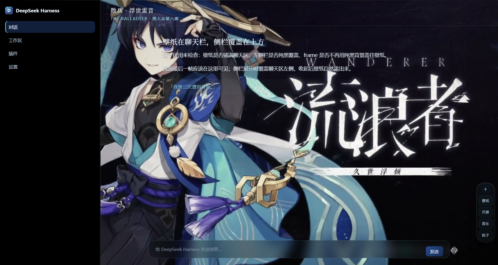
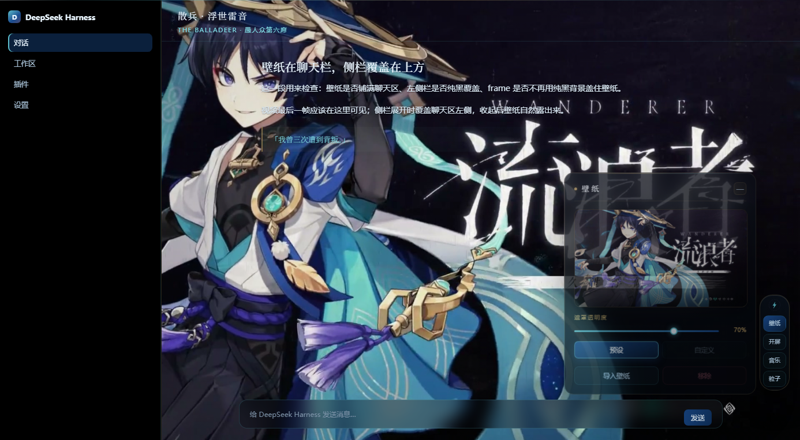
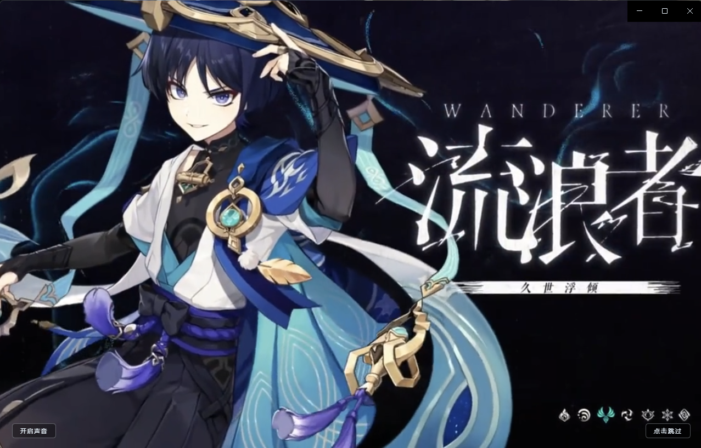

<div align="center">


# 散兵 · 浮世雷音

**A complete Scaramouche-inspired dark theme for DeepSeek Harness.**

墨黑潮底 · 深海蓝 × 青蓝 × 雾紫蓝 · 暗金细线 · 静态/视频壁纸 · 开屏视频 · 环境音乐 · 粒子 · 可拖动玻璃控制条

[](LICENSE)
[](https://github.com/deepseek-ai)
[](https://github.com/morningluu/dsh-theme-scaramouche/pulls)



*截图包含《原神》官方角色卡与开屏最后一帧，仅作非商业粉丝演示；版权归 HoYoverse 所有。*

</div>

---

## 简介

这是一个**非官方、非商业**的 DeepSeek Harness 粉丝主题，围绕《原神》角色「散兵 / 流浪者」设计。

仓库是**完整本地媒体版**：开屏视频、最后一帧预设壁纸、环境音乐都已经嵌入 `lib/client.js`，开箱即可看到完整效果；同时支持导入自己的图片/视频壁纸、粒子、遮罩透明度和可拖动控制条。主题本身不修改 DSH 的侧栏布局，所有壁纸只出现在聊天中心列。

- 完整开屏视频（含音频）+ 最后一帧预设壁纸
- 完整环境音乐（`<audio loop>`）
- 静态 / 视频壁纸：多张导入、缩略图库、任意勾选、轮切 / 循环、遮罩透明度
- 视频壁纸：本机 Blob 存储、自动抽帧 poster、静音循环、点击穿透
- 青蓝光点 / 雷光 / 雪三种粒子
- 右下角可拖动玻璃控制条，小屏自动收紧/横排，窗口缩放按相对右下角跟随
- 91 个 `--dsw-*` 设计令牌，`colorScheme: dark`
- 原生 DSH 侧栏，不做 fixed 覆盖、不改 frame 轨道
- 预设与自定义壁纸使用同一套显示层，只在聊天区出现

### 壁纸面板



### 开屏



## 安装

### 从 GitHub 安装（推荐）

```sh
dsh plugin --profile desktop add github:morningluu/dsh-theme-scaramouche
```

`desktop` 是官方桌面端使用的 profile；普通的 `dsh web` 请换成 `web`，自定义 profile 换成实际名称。

### 从源码安装

```sh
git clone https://github.com/morningluu/dsh-theme-scaramouche.git
cd dsh-theme-scaramouche
dsh plugin --profile desktop add link:"$PWD"
```

安装后**完全退出 DSH 再重开**，让客户端 bundle 重新加载。

## 使用

右侧四个入口：

| 入口 | 内容 |
|---|---|
| **壁纸** | 当前缩略图；预设 / 自定义；图片或视频导入；缩略图库；勾选任意几张；关闭 / 轮切 / 循环；遮罩透明度；移除 |
| **开屏** | 视频 / 关闭；声音开启 / 静音；重播 |
| **音乐** | 关闭 / 九彻生识；播放 / 暂停；音量 |
| **粒子** | 关闭 / 青蓝 / 雷光 / 雪 |

- **壁纸**：图片和视频都会进入本机 IndexedDB；视频保存 Blob 并自动抽一帧做缩略图。缩略图右上角勾选圈决定哪些进入轮播；轮切播完所选后停下，循环回到第一张。
- **壁纸范围**：预设和自定义都只在聊天中心列显示；侧栏保持纯黑，壁纸不会铺到整窗。
- **遮罩透明度**：0–100%，默认 70%；调黑色遮罩层透明度，不改变图片/视频本身亮度。
- **开屏**：完整视频，带声音开关和跳过；没有视频时开屏直接关闭，不播放自制纹饰。
- **音乐**：内置 96k MP3 环境音乐，浏览器自动播放策略可能要求先点击一次页面。
- **控制条**：默认右下角，可整条拖动；位置按距右下角的相对距离保存，窗口缩放/全屏后跟随边缘。
- **粒子**：在聊天内容下方，不影响阅读。

## 完整媒体说明与版权边界

> 本仓库包含《原神》官方开屏视频、最后一帧壁纸和 HOYO-MiX 音乐，用于**非商业粉丝演示**。它们**不在 MIT 授权范围内**。

- 代码、原创 SVG、文档：MIT
- 开屏视频 / 最后一帧 / 音乐：版权归米哈游 / HoYoverse 及原权利人所有
- 本项目和米哈游 / HoYoverse、DeepSeek 均无关联，未获官方授权或背书
- 不用于商业用途；若权利人要求，会移除相关素材
- 如需公开发布不含官方素材的版本，运行下面的 clean 构建

## 替换成本地媒体 / 生成干净版

```sh
# 用你自己的视频 / 音乐替换
node scripts/intro-video.cjs \
  --video "/path/to/your-opening.mp4" \
  --fallback "/path/to/your-fallback.mp4" \
  --music "/path/to/your-music.mp3"

# 查看媒体标记状态
node scripts/intro-video.cjs --check

# 生成不含官方素材的干净版
node scripts/intro-video.cjs --clean
```

脚本会把视频/音频压缩并以 base64 嵌入 `lib/client.js`；`.cache/` 和原始媒体默认被 `.gitignore` 忽略。替换后的素材版权仍归其权利人，请勿超额分发。

## 兼容性

- DeepSeek Harness 0.2.x（声明 `engines.dsh >= 0.2.0`）
- 桌面端与 `dsh web` 均可
- 客户端主题需要宿主支持 `dsh.client` / `@deepseek-ai/dsh-client-ui-theme`

## 项目结构

```text
dsh-theme-scaramouche/
├─ lib/
│  ├─ client.js          # 主题 + 完整开屏/壁纸/音乐媒体（本地媒体版）
│  └─ index.js           # 服务端占位 apply
├─ locale/{zh,en}.json
├─ scripts/intro-video.cjs
├─ assets/
│  ├─ icon-180.png
│  ├─ screenshot-1.png
│  ├─ screenshot-2.png
│  └─ screenshot-3.png
├─ cordis.patch.yml
├─ screenshots.json
├─ package.json
├─ NOTICE.md
├─ LICENSE
└─ README.md
```

## 开发

```sh
node --check lib/client.js
node scripts/intro-video.cjs --check
node scripts/intro-video.cjs --clean
```

欢迎 issue / PR，但请保持公开版本的媒体版权声明完整。

## 版权与免责声明

- **代码与原创 SVG**：MIT，见 [LICENSE](LICENSE)。
- **非官方粉丝项目**：本项目与米哈游 / HoYoverse、DeepSeek 均无关联，未获官方授权或背书，不用于商业用途。
- **《原神》相关名称、角色、开屏视频、最后一帧壁纸与音乐**：版权归米哈游 / HoYoverse 及原权利人所有。仓库中的媒体仅用于非商业粉丝演示，**不纳入 MIT 授权**，不应被再分发或商用。
- **下架**：如权利人认为本项目内容不当，请通过 issue 联系，我们会移除相关内容。
- 本声明不构成法律意见。

完整说明见 [NOTICE.md](NOTICE.md)。

## 致谢

- [DeepSeek Harness](https://github.com/deepseek-ai) 提供插件与主题机制
- [dsh-market](https://github.com/dsh-market/dsh-market) / [awesome-dsh-plugin](https://github.com/awesome-dsh-plugin/awesome-dsh-plugin) 提供插件市场与收录目录
- HOYO-MiX《九彻生识 Novatio Novena》与《原神》角色素材，版权归原权利人

## License

[MIT](LICENSE) © 2026 Moringluu

> 官方媒体素材不在 MIT 范围内，详见 [NOTICE.md](NOTICE.md)。
